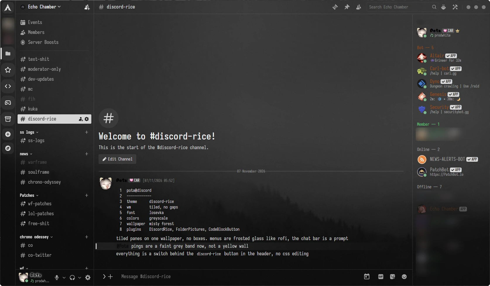
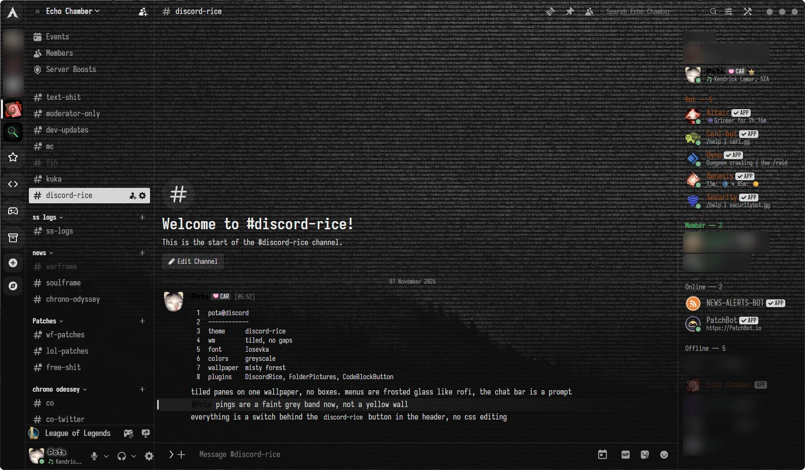
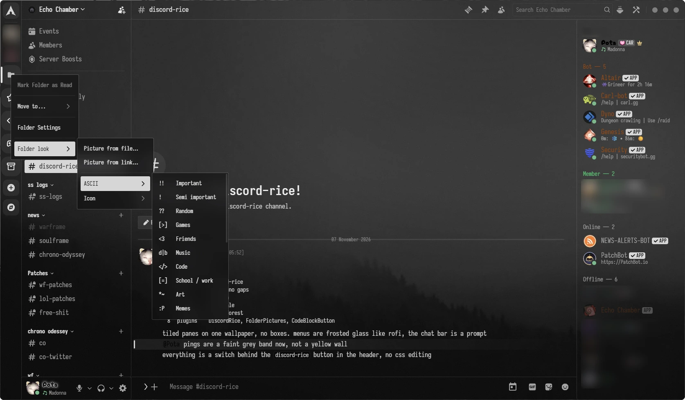

# discord-rice

Discord made to look like a tiling-WM Linux rice: a theme and a few small plugins, for [Vencord](https://vencord.dev) and [BetterDiscord](https://betterdiscord.app). One installer sets up all of it, and it keeps itself up to date.



## The theme

`discord-rice.theme.css`. One file, written against Discord's own styles. It loads nothing else but the font.

- **Tiled, no gaps.** One misty wallpaper behind the whole window, with the columns split by 1px lines. No floating panels, boxes or shadows, and no top bar. Calls show the wallpaper behind the tiles too, instead of black.
- **Greyscale.** Made to sit on a black-and-white desktop. Server icons and folders are black-and-white too. Only status dots, unread badges and red "danger" buttons keep a muted colour.
- **Terminal touches.** Iosevka everywhere, and the chat bar is a `❯` prompt whose line lights up while you type. The selected channel is a solid bar like ranger's cursor (a faint tint for the voice channel you're in), categories are bold like directories in `ls`, and message times sit in `[brackets]`.
- **Menus like rofi.** Right-click menus, the emoji/GIF picker and other popouts are dark frosted glass with a thin border.
- **Plain folders.** A closed folder shows a folder icon instead of a 2×2 grid of tiny server icons. With the folder plugin it can show a picture, an icon or a bit of ASCII instead.
- **ASCII wallpaper.** With the discord-rice plugin, the wallpaper can be redrawn out of characters, digits or 0s and 1s, like the fetch screenshots on r/unixporn.
- **Less clutter.** Nitro, Shop and Quests are gone from the DM list, and so are the quest card above your user panel, nameplates behind names, the notification bell in the channel header, the video call button in DMs (voice call stays), and the gift and apps buttons in the chat bar. The DM profile button hides while Discord has it greyed out.
- **Small fixes.** The game page (click the game you're playing) opens as a smaller centred window, so its close button isn't stuck under the window controls. Drag the window by the empty space in the channel header. On small windows the header search box shrinks so the channel name stays readable.
- **Light on Discord.** No other theme is loaded underneath, and the rules are written and measured so that clicking around and switching channels costs about the same as with no theme at all.

### Install

You need [Vencord](https://vencord.dev) (or [Vesktop](https://github.com/Vencord/Vesktop), which has Vencord built in) or [BetterDiscord](https://betterdiscord.app). The theme works on its own; the plugins below are optional extras.

**The installer.** It finds the mods you have, copies the theme into each one, and offers to set up the Vencord plugins too.

Windows, in PowerShell:

```powershell
irm https://raw.githubusercontent.com/Plyxen/discord-rice/main/install.ps1 | iex
```

Linux and macOS:

```sh
curl -fsSL https://raw.githubusercontent.com/Plyxen/discord-rice/main/install.sh | bash
```

If you'd rather read a script before running it, download the repo and run `install.ps1` or `install.sh` from its folder; they do the same from the local files. What they do:

- **Vencord and Vesktop:** the theme file goes into the themes folder.
- **BetterDiscord:** the theme file and the plugins, which are single files that go into its plugins folder.
- **The Vencord plugins,** after asking: see [The plugins](#the-plugins). This is the only part that needs anything installed (git and Node.js), and the script only tells you if they are missing.

Then turn the theme on in Discord: **Settings → Vencord → Themes** (or **Settings → Themes** under BetterDiscord) **→ discord-rice**. In BetterDiscord, also turn the plugins on under **Settings → Plugins**.

| Windows | Linux, macOS | |
| --- | --- | --- |
| `-ThemeOnly` | `--theme-only` | The theme only, without asking about the plugins. BetterDiscord still gets its updater plugin. |
| `-Plugins` | `--plugins` | Set up the plugins too, without asking. |
| `-Orion` | `--orion` | With the plugins, also add Orion without asking, or update it. See [Orion](#orion). |
| `-VencordDir <folder>` | `--vencord-dir <folder>` | Where the Vencord source is, or where to download it to. |
| `-NoInject` | `--no-inject` | Build Vencord with the plugins, but don't point Discord at the build. |
| `-Uninstall` | `--uninstall` | Remove what the installer put in. Vencord and BetterDiscord themselves stay. |

To pass an option to the one-line form: `curl ... | bash -s -- --plugins`, or on Windows `& ([scriptblock]::Create((irm https://raw.githubusercontent.com/Plyxen/discord-rice/main/install.ps1))) -Plugins`. Running the installer again replaces what it installed and leaves everything else alone.

**By hand, Vencord: online link.** In Discord, open **Settings → Vencord → Themes → Online Themes** and paste:

```
https://cdn.jsdelivr.net/gh/Plyxen/discord-rice@main/discord-rice.theme.css
```

**By hand, as a file.** Download `discord-rice.theme.css`, open the themes folder (**Settings → Vencord → Themes → Open Themes Folder**, or **Settings → Themes → Open Themes Folder** under BetterDiscord), drop the file in, and turn on **discord-rice** in the list. Edits to the file show up live.

### Updates

| How you have it | The theme | The plugins |
| --- | --- | --- |
| Vencord with the plugins | `RiceUpdater` replaces the theme file | `RiceUpdater` fetches them, rebuilds Vencord and offers a restart |
| Vencord, online link | Vencord fetches it on every start; jsDelivr can take up to a day to pick up a new version | |
| Vencord, theme file only | Doesn't update. Use the link instead, or run the installer again | |
| BetterDiscord | `DiscordRiceUpdater` replaces the theme file | `DiscordRiceUpdater` replaces the plugin files, and BetterDiscord reloads them on the spot |

Both updaters work the same way. Shortly after Discord starts, and every six hours after that, they ask GitHub whether this repo has a new commit, fetch what changed, check each file against GitHub's listing, and put it in place. They talk to nothing but this repo.

- **Your own changes are safe.** A file is only replaced if nobody changed it on your PC since the updater last looked at it. If you edited the theme file or a plugin, the update is held back and you are told; **Replace my changes** in the updater's settings takes it anyway, and keeps your theme file as `.bak`.
- **You choose how.** `RiceUpdater` (under **Settings → Vencord → Plugins**) can install updates by itself, tell you first, or not check at all. New plugins load when Discord restarts; the notification's click does that.
- An updater that installs by itself means trusting this repo's future commits, like with any program that updates itself. "Tell me first" or "Don't check" are there if you'd rather not.

### Options

The easy way is inside Discord: the **rice bowl button** in the channel header, where the inbox button used to be, opens the discord-rice window, a small terminal-style settings tool with every option below. The same window is under **Settings → discord-rice** (in the Vencord section), or in BetterDiscord behind the cog of the DiscordRice plugin. It comes from the DiscordRice plugin, which also opens it once the first time you start Discord with it. Changes apply straight away.

Without the plugin, every option is a CSS variable at the top of the theme file. You can edit the file, or leave it alone and put your changes in the mod's own CSS box, which is read after the theme: **Settings → Vencord → Themes → Edit QuickCSS**, or BetterDiscord's **Custom CSS**. For example `body { --hide-sticker-button: on; --corners: 0px; }`.

| Variable | Default | What it does |
| --- | --- | --- |
| `--wallpaper` | misty forest | Any image, e.g. `url('https://i.imgur.com/....jpg')`. imgur, Pinterest (`i.pinimg.com`), github.io and raw.githubusercontent.com links work. |
| `--wallpaper-dim` | `0.5` | How dark the wallpaper is, from 0 to 1. Raise it if text is hard to read. |
| `--grain` | `on` | Film grain over the wallpaper. |
| `--font` | `'Iosevka'` | `''` for Discord's own. `--code-font` is the same for code blocks. |
| `--corners` | `3px` | Corner size. `0px` for dead sharp. Avatars and pills stay round. |
| `--plain-folders` | `on` | Closed folders show a folder icon. `off` brings back the 2×2 grid. |
| `--mono-server-icons` | `on` | Black-and-white server icons and folders. `hover` shows colour under the mouse; `off` keeps colour. |
| `--glass-menus` | `on` | Frosted-glass menus and pickers. `off` makes them solid. The tint and blur are `--float-tint` and `--float-blur` (in the `:root` block). |
| `--hide-quests` | `on` | The quest card above your user panel, and quest embeds in chat. |
| `--hide-nameplates` | `on` | The picture strips behind names in the member list, DM list and user panel. Shop and settings previews stay. |
| `--hide-store-tabs` | `on` | Nitro Home, Shop and Quests in the DM list. |
| `--hide-gift-button` | `on` | Gift button in the chat bar. |
| `--hide-apps-button` | `on` | Apps / activities button in the chat bar. |
| `--hide-sticker-button` | `off` | Sticker button in the chat bar. |
| `--hide-notification-button` | `on` | The bell in the channel header. Right-click a channel for the same settings. |
| `--hide-video-call-button` | `on` | The camera in the DM header. The voice call button stays, and you can turn your camera on once in the call. |
| `--home-icon` | `arch` | Arch logo on the home button. `discord` brings back Discord's logo. |
| `--mono-window-controls` | `on` | Grey window dots instead of red / yellow / green. `--dot-size` is their size. |
| `--corner-room` | `168px` | Room kept free at the right end of the channel header, where the inbox, plugin buttons and window dots sit now that there is no top bar (in the `:root` block). Raise it if a plugin adds more buttons there. |
| `--line`, `--line-focus`, `--float-border` | faint / light grey | The lines between panes, the chat bar's line while typing, and the border around menus (in the `:root` block). |
| `--mention` | faint grey band | The background of messages that ping you (in the `:root` block). |

The rest of the `:root` block is the colours: text, the see-through layers and solid surfaces, the light greys that stand in for Discord's blurple, and the muted status colours, each with a comment saying where it shows up.

The wallpaper is embedded in the theme (the long line at the bottom), so it needs no hosting. `background.jpg` is the same image, at only 736×414, so for a sharper look point `--wallpaper` at a bigger copy.

## The plugins

There are four, and they come for both mods. They're optional: the theme works without them.

| Plugin | What it does |
| --- | --- |
| DiscordRice | The settings window, the theme's switches and the ASCII wallpaper. |
| FolderPictures | A look of its own for a server folder: a picture, an icon or a bit of ASCII. |
| CodeBlockButton | A ``` button in the popup you get when you select text in the chat box. |
| RiceUpdater (in BetterDiscord: DiscordRiceUpdater) | Keeps the theme file and the plugins up to date, see [Updates](#updates). |

### In BetterDiscord

The plugins are the `.plugin.js` files in `betterdiscord/`. The installer copies them into BetterDiscord's plugins folder; by hand, open **Settings → Plugins → Open Plugins Folder** and drop them in. Then turn them on in that list. Nothing has to be built.

- DiscordRice and FolderPictures are the very same code as the Vencord plugins, built into one file each, so the window, the switches and the folder looks are the same. The settings window opens from the rice bowl button and from the cog of the DiscordRice plugin; there is no page for it in Discord's settings.
- CodeBlockButton is written separately for BetterDiscord, because the Vencord one works by rewriting Discord's own code, which BetterDiscord can't do. It does the same job: it puts the selected text inside ``` and takes them off again on a second click.
- To build the two shared ones after changing their source: `node betterdiscord/src/build.mjs <a Vencord source folder>`. It uses the bundler from that Vencord folder and installs nothing.

### In Vencord

The plugins are the folders in `vencord-plugins/`. User plugins can't be added to the normal Vencord install; they need Vencord built from its source.

**With the installer.** Say yes when it asks about the plugins, or run it with `-Plugins` / `--plugins`. It needs [git](https://git-scm.com) and [Node.js](https://nodejs.org) (22 or newer) and does the rest:

1. If Discord or Vesktop already runs a Vencord source build, it uses that. Otherwise it downloads Vencord's source into a `Vencord` folder in your user folder.
2. It copies the plugin folders into `src/userplugins/` and builds Vencord. The package manager Vencord uses (pnpm) is fetched for that one run if you don't have it.
3. If Discord didn't run that build already, it points Discord at it with Vencord's own installer. Quit Discord first; the script waits.

Fully restart Discord afterwards. The plugins are on by default, and your Vencord settings and themes carry over. **Settings → Vencord → Updater** keeps working: it pulls Vencord and rebuilds, and the plugins stay. For **Vesktop**, point it at the build yourself: **Settings → Vesktop Settings → Vencord Location** → the `dist` folder inside the Vencord folder.

#### Orion

After the plugins question the installer asks one more: whether to add [Orion](https://github.com/nyxxbit/discord-quest-completer) too. The answer defaults to no.

- **What it is.** Somebody else's Vencord plugin (OrionQuests) that completes Discord Quests without playing them. It is not part of discord-rice, and nothing in it is checked or kept up by this repo.
- **The risk.** Orion's own README says Discord has been restricting accounts for quest automation since April 2026. Read it before you say yes; that part is between you and your account.
- **Why it is offered here.** Vencord runs one build at a time, and Orion's own installers bring a whole Vencord of their own, which drops these plugins. Putting Orion into the same build is how both stay.
- **What saying yes does.** It downloads Orion's newest code from its own repo into `src/userplugins/discord-quest-completer` and builds Vencord with it. If Orion is already in the build under another name, it is left as it is. If Vencord doesn't build with Orion in it, Orion is taken out again and the rest is installed.
- **Afterwards.** Turn on **OrionQuests** under **Settings → Vencord → Plugins**. RiceUpdater never touches it; run the installer again with `-Orion` / `--orion` to update it. Uninstalling discord-rice leaves Orion in place: delete its folder to remove it.

**By hand.** This is what the installer does, with [pnpm](https://pnpm.io) installed. Vencord's own guide is [here](https://docs.vencord.dev/installing/custom-plugins/).

```sh
git clone https://github.com/Vendicated/Vencord
cd Vencord
pnpm install --frozen-lockfile
```

Copy the folders from `vencord-plugins/` into `Vencord/src/userplugins/` (create the folder if it isn't there), so you end up with `src/userplugins/discordRice/index.tsx` and so on. Then build it and install it into Discord:

```sh
pnpm build
pnpm inject
```

Fully restart Discord (quit from the tray, not just the window). For Vesktop, skip `pnpm inject` and set the Vencord Location as above.

After changing a plugin yourself, copy it in again, run `pnpm build`, and restart Discord.

### discord-rice settings

`discordRice` puts a rice bowl button in the channel header, in place of the inbox button (you can bring the inbox back with the "inbox button" switch). The button opens the discord-rice window: a small terminal-style settings tool, styled like the rest of the rice. The same window is under **Settings → discord-rice** and in the Vencord toolbox, and it opens by itself once, the first time you start Discord with the plugin.

![The discord-rice window on its look tab: a tab list on the left, font choices, block sliders for corners and gaps, and [x] switches](screenshots/settings.webp)

| Tab | What's in it |
| --- | --- |
| about | A neofetch-style summary (your name `@discord`, theme, font, corners, wallpaper, folders, plugins and a colour row), the **theme** switch, which plugins are on, and tips. |
| look | Font, corners, gaps, frosted-glass menus and grey window dots. |
| wallpaper | The wallpaper link, how dark it is, film grain, and the ASCII wallpaper. |
| hide | The inbox button, notification bell, video call button, chat bar buttons, nameplates, quests and store tabs. |
| servers | Plain folders, black-and-white icons and the Arch logo. |
| folders | Every server folder with its look. Open one to pick an ASCII or icon preset, type your own text, or set a picture from a link or a file. Needs FolderPictures. |

- The number keys 1–6 switch tabs, space flips a switch, the arrow keys move a slider, and Esc closes the window. **↺ reset defaults** (click it twice) puts every option back.
- The **theme** switch turns the theme on or off, whether you installed it as a file or as the online link.
- It works by setting the theme's CSS variables from a small style sheet, which beats the theme file's defaults. Turn the plugin off and the theme file's own values come back.

**ASCII wallpaper** redraws the wallpaper (yours or the default one) out of text, sized to your screen:



| Mode | Looks like |
| --- | --- |
| Characters | `.:-=+*#%@`, denser characters where the picture is brighter. |
| Digits | Random digits everywhere, brighter where the picture is. This one looks best on the misty forest. |
| Binary | The same with `0` and `1`. |

The character size slider goes from 6px (fine, more detail) to 16px (chunky). The wallpaper has to allow being read by the page: the default one and imgur links do, and if one doesn't you get a message and the normal wallpaper stays.

### Folder looks

`folderPictures` gives a server folder its own look, inside the folder and framed by its colour, in place of the folder icon or the 2×2 grid. Right-click a folder → **Folder look**:

- **Picture from file…** Pictures are cropped square from the middle and shrunk to 128px. GIFs up to 1 MB are kept as they are, so they stay animated.
- **Picture from link…** Paste an image link. For Pinterest, open the pin, right-click the picture → **Copy image address** (an `i.pinimg.com` link) and paste that. imgur and Discord image links work too. Pinterest and imgur pictures are cropped and saved like files; other sites only work if Discord allows loading from them.
- **ASCII** A few characters in the folder's colour, in the code font. There are presets, or **Your own text…** for up to 5 characters.
- **Icon** A line icon in the folder's colour.
- **Back to normal** shows up once a folder has a look.



The presets come in pairs, the same name as ASCII and as an icon:

| Preset | ASCII | Preset | ASCII |
| --- | --- | --- | --- |
| Important | `!!` | Anime | `^.^` |
| Semi important | `!` | Hot | `~*~` |
| Random | `??` | Night | `zZ` |
| Games | `[>]` | Chill | `c[_]` |
| Friends | `<3` | Bots | `[o_o]` |
| Music | `d\|b` | Dead | `x_x` |
| Code | `</>` | Archive | `[_]` |
| School / work | `[=]` | Home | `~/` |
| Art | `*~` | Terminal | `>_` |
| Memes | `:P` | Fast | `/!\` |

- The **folders** tab of the discord-rice window lists every folder with its look; open one to change it. **Settings → Vencord → Plugins → FolderPictures** has a plainer list with a preset picker and File / Link / Text / Reset buttons.
- Looks are stored locally and never uploaded.
- With `--mono-server-icons` on, pictures are black-and-white like everything else in the server list.

### Code block button

`codeBlockButton` adds a ``` button next to `<>` in the popup that appears when you select text in the chat box. It wraps the selection in a code block, and clicking it again unwraps it.

### Updater

`riceUpdater.desktop` is the plugin behind [Updates](#updates). Its settings (**Settings → Vencord → Plugins → RiceUpdater**) have the three ways to handle an update, a line saying what the last check found, and **Check now** and **Replace my changes** buttons. It only looks after the theme file (if you use one) and the plugin folders that come from this repo; other user plugins you have are not touched.

## Known limits

- The **notification bell**, **video call**, **sticker button** and **gift button** switches, and the hiding of the greyed-out DM profile button, find those buttons by their English labels, so they do nothing when Discord is set to another language. Everything else works in any language.
- The theme is made for Discord's dark mode on desktop.
- The BetterDiscord side (the theme's rules for its interface, and the four plugins) is written from BetterDiscord's and Discord's source and tested on a stand-in page, not inside a running BetterDiscord. If something is off there, please open an issue.
- The installers are tested on Windows. `install.sh` is tested with fake folders, not on a real Linux or macOS install.
- In BetterDiscord the inbox button is hidden from the outside instead of never being drawn, and the folder looks find a folder by an id Discord puts on it. Both can stop working after a Discord update until this repo catches up; the rest of the plugins keeps working.
- The ASCII wallpaper needs a picture the page is allowed to read: the default one and imgur links work; some sites don't allow it.

## When Discord updates break it

The theme stands on its own, so a fix has to land here: when Discord renames its classes, the rules that use exact class names stop working until the theme is updated. The colours come from Discord's named colour variables, and most switches match links and labels (`href`, `aria-label`), which usually survive renames.

The rules that use exact class names, and may need updating after a big update: the layout (no top bar, the user panel under the channel list, the window dots), the pane lines, the prompt, the selected channel bar, plain folders, the quest card, the timestamp brackets, menu styling, the game page window, the header search and the user panel spacing. If one stops working, the rest of the theme still works.

## Credits and licence

discord-rice is licensed under the [GPL-3.0-or-later](LICENSE), like Vencord. Third-party licence texts are in [THIRD_PARTY_NOTICES.md](THIRD_PARTY_NOTICES.md).

- Font: [Iosevka](https://github.com/be5invis/Iosevka) by Belleve Invis (OFL), via [Fontsource](https://fontsource.org) on jsDelivr.
- Home icon: the Arch Linux logo from [Simple Icons](https://simpleicons.org) (CC0). The logo is a trademark of Arch Linux.
- Folder icons: [Lucide](https://lucide.dev) (ISC; a few from [Feather](https://feathericons.com), MIT).
